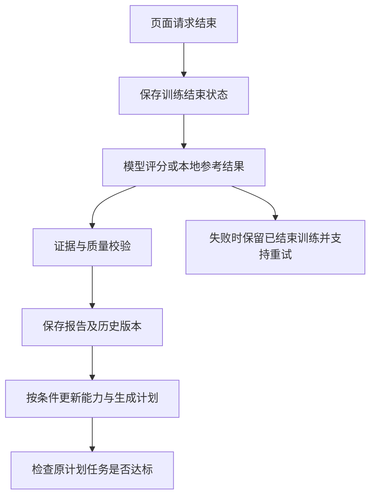

# 接手认知成本与简化方案

> 以下为改造前审计。用户授权后的实现与验证见 [接手简化重构验收](接手简化重构验收-2026-11-17.md)，当前开发入口见 [开发接手指南](../开发接手指南.md)。下文行号、文件规模与职责分布用于记录当时的问题，不代表当前实现。

## 结论与范围

当前项目的接手成本为中高。目录与技术选型容易理解，难点集中在跨文件的生命周期、数据含义与隐藏副作用。上一轮已移除了部分历史执行链路，但接手者仍需要读实现才能确认“什么会被保存、什么时候生成报告、哪些分数可比较、来源不在时如何处理”。

本次检查当前工作区、启动与架构文档、路由、数据模型、核心服务、前端组件和测试组织；只新增本文，没有修改业务实现或数据库，没有把静态风险判断写成已通过的运行验证。

假设接手者熟悉 Python、TypeScript、SQL 与常见 Web 工程，且能取得必要配置，估计：

| 理解程度 | 预计投入 | 主要障碍 |
| --- | --- | --- |
| 启动离线环境并跑通主要测试 | 半天至一天 | 原生音视频依赖、环境配置、文档版本差异 |
| 完成普通页面或 CRUD 小修改 | 一至两天 | 页面和类型查找、接口约定 |
| 安全修改评分、计划及成长统计 | 三至五个工作日 | 质量口径、来源、重评、持久化边界 |
| 独立处理音视频异常与跨链路回归 | 一至两周 | 浏览器设备、PCM、ASR 事件、录制收尾、重连与竞态 |

这是评估估算，时间层级有重叠，不应相加。没有新工程师实际接手实验，不能把它当效率测量。“理解整个项目”也不等于逐行读完：应以能解释关键链路并安全完成改动为标准。

## 1. 最需要上下文的隐含规则

1. TrainingSession 的 FINISHED 表示训练结束，不表示报告必然存在。
2. 结束会保存并总结，直接退出会丢弃；超时、失败、重试期间还要区分用户是否已经选择保留。
3. 一轮可总结、至少两轮才可能进入成长比较、计划任务完成另有轮次条件；三个门槛不同。
4. 文字的 USER(n) 回答 AI(n−1)，音视频的 USER(n) 回答 AI(n)。
5. `correctness` 主要表示“信息完整”，专业事实核查在 `technicalChecks`，不是同一项。
6. degraded 表示模型降级，qualityStatus 表示报告质量状态，eligibleForGrowth 表示产品统计资格，不能互相替代。
7. 微课是计划中的固定快照；已有学习进度时 force 请求也可能被忽略，以保护回看内容。
8. 读取 v2 计划不应生成课程或推断最近来源；显式生成微课的函数另有“最近评分”回退，不能把两条路径混为一谈。
9. 退出登录前要调用页面注册的清理回调；组件尚未挂载时还要从路由补会话 ID。
10. 同一个服务方法可能生成报告、更新能力值、创建计划并提交事务，调用方不能仅根据函数名判断副作用。

这些规则应成为一页领域说明和契约测试，而非靠阅读 Git 历史才能获得的知识。

## 2. 重点发现与简化方案

### P0：轮次含义分裂，已出现实现不一致

证据：

- `backend/app/features/training/message_order.py:7` 明确说明两种轮次语义。
- `backend/app/features/evaluations/quality.py:12` 使用文字 offset=1、音视频 offset=0。
- `backend/app/features/evaluations/service.py:601` 又实现一次题型对应逻辑。
- `backend/app/features/training/comparison.py` 的 same_question_attempts 直接用 AI.round_no == round_no 找问题，没有使用文字偏移。

新工程师看到 round_no 很容易当成统一的“第几道题”。这已不仅是命名成本：文字报告在第 n 个回答处发起比较时，可能选中后一个问题的对比记录，导致当前回答和比较对象不是同一道题。本次根据代码确认规则不一致，未运行专门的文字同题复现。

方案：先建立唯一的 `answer_turns(messages, channel)`，返回明确的 `answerRound / questionMessageId / answerMessageId / question / answer`。报告、证据、题型和同题比较全部消费它。下一阶段持久化明确的问答关联，逐步停止在业务代码中计算 n−1。保留旧消息编号，通过适配器读历史数据，不直接批量给旧轮次加减一。

验收：同一份两题对话分别以 TEXT/VOICE/VIDEO 保存后，报告、引用和同题比较得到相同问答配对；重复请求、同时间戳及开场轮也覆盖。

### P0：训练完成与报告完成交织，跨域副作用不透明

入口：`training/router.py:270` → `training/service.py:323` → `evaluations/service.py:154`。

finish_session 先提交 FINISHED，evaluate_session 再调用模型、落库、更新能力值、按条件创建计划；路由随后尝试完成原计划任务。报告失败时训练可能已经保存。create_plan 和 force 又改变副作用范围。

评价函数 164 行、评分服务 918 行不是唯一问题；真正难点是一次调用的事务、幂等和后续动作分散在不同层。

方案：增加一个具体的应用用例 `end_training_attempt`，清楚列出“标记结束 → 生成或重试报告 → 首次有效结果更新能力/计划 → 尝试完成任务”。保留模型调用前后明确的短事务，不让长时间模型请求占用整个数据库事务。

拆分方向：

- 评分策略与模型采样：输入对话、返回评分草稿，不操作数据库。
- 证据与质量规则：验证草稿是否可用。
- 报告持久化：处理原 ID、版本和证据替换。
- 计划生成与能力更新：由用例明确调用，不埋在通用“评分”函数内。

可分别表达训练状态与报告状态；样本不足、规则参考等仍属于质量信息。无需把所有状态拼成一个巨大枚举。

验收：首次结束、重复结束、重评失败、补证成功、计划中发起的提前结束，均能列出是否产生新计划、是否更新能力、是否完成原任务。

### P1：退出清理借助模块级回调，认证模块依赖训练页面

`frontend/src/composables/useInterviewExit.ts:5` 的 activeCleanup 是隐藏的全局可变状态。useAuth.logout 调用它，AppShell.signOut 还负责解析 training/voice/video 路由里的会话 ID。组件加载先后会影响退出语义。

这些保护解决了真实竞态，应保留行为；简化对象是隐式依赖关系。

方案：由应用壳持有明确的当前训练尝试状态：会话 ID、是否已请求保留、是否正在丢弃。页面负责登记尝试，壳负责按顺序“清理尝试 → 注销认证 → 跳转”。useAuth 回归只处理认证；路由 ID 的解析集中在一个适配函数。当前体量使用一个小组合式状态模块即可，无需新引入状态管理框架或事件总线。

验收：尚未加载页面、已作答、模型回复中、报告生成中、组件卸载、退出失败重试，均不漏清理或删除已结束报告。

### P1：LiveInterviewRoom 同时拥有协议、设备、录制、提交和 UI

文件 909 行，其中脚本约 744 行。它管理两种协议事件、PCM 重采样、音频队列、设备权限、MediaRecorder、Live2D、倒计时、自动回退和报告上传。

`sessionId` 与 `savedSessionId` 在通常的准备流程里是同一会话的不同提交阶段。`stop()` 还会增加序号、取消异步结果、清空播放、关设备与连接，并改变 closing；读者必须跟踪多个布尔值才能理解一次调用。

方案：按资源和副作用所有权拆三块，组件保留展示和意图调度：

1. 协议适配器把豆包/本地管线的事件转换为统一的“识别更新、回答完成、提问文本、音频帧、连接状态”。
2. 媒体组合式函数拥有麦克风、播放与录制，并提供幂等的释放操作；记录最后数据块的收尾顺序写成明确方法。
3. 提交组合式函数拥有“答案未上传 / 已上传 / 报告就绪”的状态和重试，防止用第二个 ID 暗示阶段。

场景传输方式使用 captureMode，阶段使用 phase，结束决定使用 keep/discard；保留逐次请求序号、权限拒绝提示、AudioContext 恢复及迟到设备流释放。拆分后不要求页面了解 PCM 帧、WebSocket 原始事件或具体引擎差异。

### P1：delivery 与宽泛 dict 形成隐形数据模型

`db/models.py:170` 的 delivery 同时承载音频指标、镜头指标、转写、切片、学习者自评、rescoreRequired 和 pendingEvaluationSnapshot。前端对应类型又把部分音频字段设为必填，实际文字或准备会话可能没有它们。

此外，`evaluations/service.py:272` 将 technicalChecks 放进 speech_stats。这使“语音指标”同时包含专业内容核查，接手者难以凭名称定位。

方案先保持存储不动，用 Pydantic/TS 类型明确分出音频观测、镜头观测、转写、复盘状态和专业内容核查，通过访问器读取历史 JSON。再让重评标记与旧报告快照归报告生命周期管理；是否拆数据库字段放到独立迁移，不与页面拆分混在一次改动里。

backend schema 先收紧，之后从 OpenAPI 生成前端类型。直接为现有任意 dict 生成 TS，只会得到另一份 unknown，不能解决契约问题。

### P1：分数名称跨越多个语义体系

| 代码键 | 产品含义 | 容易产生的误解 |
| --- | --- | --- |
| logic | 内容与逻辑 | 只关注结构词 |
| relevance | 贴合问题 | 与推荐场景相关度混淆 |
| correctness | 信息完整 | 误认为专业答案正确率 |
| concision | 表达干净 | 误认为越短越好 |

objectives 又使用 content、clarity、completeness，多个文件维护同一组标签。mode 也有三个语义：训练策略 STANDARD/DRILL、页面输入 text/voice、实时房间 voice/video；depth 的标准档又叫 STANDARD。

方案：建立领域词汇表。将训练策略命名为 trainingMode、输入控件命名为 inputMode、媒体方式命名为 channel/captureMode。评分内部统一使用信息完整与表达清晰的准确名称，外部旧 correctness/concision 键通过序列化映射保留；数据库与客户端升级单独安排。专业事实核查继续独立，避免改字段名时意外改评分口径。

Training 是包括基础能力对练在内的统称，Interview 是其中的使用场景，不能盲目把所有 training 重命名为 interview。

### P1：ReportView 是多个功能的聚合控制器

总计 1154 行，约 473 行脚本、405 行模板、274 行样式与标签。它同时处理成绩展示、STAR 启发式、逐题回放、同题对比、分享撤销、转写编辑、重评、自评、岗位匹配与行动建议。

CSS 行数不应算成同等业务复杂度；不过修改一项交互仍需排查多个 watcher、请求与局部状态。

方案：先抽出 `useTrainingReport` 数据加载与重评、`useReportSharing` 分享生命周期、`TranscriptReview` 转写与自评、`DialogueReplay` 逐题回放和同题比较。既有雷达、质量提示、证据组件继续复用。路由页只选择展示区块，不再拼接提示规则或管理表单保存。

验收：拆分前后报告内容一致，失败重评保留可读报告，文本知识题不被套入经历题 STAR，分享撤销和原话引用不回归。

### P2：normalized_tasks 名称与返回契约不相符

`plans/service.py:292` 目前已经不再推断历史来源，这一点很好。但它以 PlanTaskView 校验、序列化，再用原 dict 覆盖结果。函数实际做的是“校验并保留额外字段的副本”，不是一个可依赖的规范化输出。

额外字段包括微课视频元数据，直接改成 model_dump 会丢失它们。先给任务区分 REPORT/REWRITE/COURSE/RETEST 等明确类型，并为 lessonVideo 等元数据建类型，再改名为 `validated_plan_tasks` 或 `task_views`。保留少量明确分支即可，不为每种任务创建策略类、工厂与注册器。

### P2：微课“个性化、回看、重新生成”藏在一个函数里

`plans/service.py:374` 的 personalized_lesson 同时选择素材、保护旧快照、解释 force、寻找评分来源、调用模型和保存内容。已有进度或计划非 ACTIVE 时 force 会被忽略；缺少评分来源时还会取该用户最近报告。

这些操作发生在显式 POST，不能混同于只读 GET 的课程视频查询；但调用方仍需读 124 行才能知道是否会生成或更换来源。

方案：明确 `get_lesson_snapshot` 与 `generate_lesson_snapshot`；生成输入显式指定 reportId，来源缺失时使用明确的通用课策略或返回可解释错误。用具体生成策略替代含糊的 force。继续保护已学习内容和缓存，不为命名统一触发历史视频重建。

### P2：服务文件按技术角色命名，真实职责仍太多

- evaluations/service.py 918 行：评分、计划生成、错题、复习状态、版本、报告投影。
- training/service.py 801 行：创建、回复、删除、归档、提示、改写与岗位匹配。
- admin/router.py 760 行：用户、场景、课程、报表、密码请求、录像、审计、用量，且路由里直接查询和计算。

方案按用例拆分，不创建通用 BaseService/Repository 来搬运 ORM：报告评分、报告查询、计划生成、错题复习；训练尝试、回复、岗位上下文；管理用户、内容、报表、运维。保持功能域目录，文件名直接暴露职责。对提交事务的函数增加清晰约定，避免简单工具函数隐式 commit。

### P2：测试入口依赖测试文件，模型替身依赖提示词片段

当前有 14 条从 test_* 或 tests.* 导入的语句，其中既有合理的帮助函数，也有测试模块互相借用 fixture、模型响应和样例。离线浏览器服务直接导入 test_product_upgrade.model_response，后者用“评分员”等提示词片段选择响应。

方案：将 client、认证、对话/计划工厂和模型替身集中到 conftest 与 tests/support，测试文件不再承担公共库职责；离线服务只依赖 support。模型替身按明确调用类型或输入 schema 匹配，减少改提示词文案时无关测试一起失败。

保留 conftest 的独立临时数据库和禁用真实模型配置，这是新工程师可以安全运行测试的重要保障。需要分别给出离线、真实模型和设备浏览器验证的命令与边界。

## 3. 过度抽象与必要复杂性

LangGraph 当前只有 safety → advance → prompt 三个线性节点，实际模型调用在服务层；没有使用持久化 checkpointer。当前三步流程的框架成本偏高，职责集中在面试阶段编排。优先让节点成为可单独阅读、测试的纯规则，通过一个公开入口调用；暂不把移除框架放在首批改造。

SQL 与 Python 两条评分资格判断也不能为“去重”而合并成全量加载后过滤。保留 SQL 过滤保障分页与查询性能，用统一契约样例验证两种实现等价。音频双引擎、播放恢复、权限引导、缓存与历史迁移同样有真实职责，应改善命名和所有权。

## 4. 文档入口应补什么

README 仍写 Redis 为状态存储，并提到内存状态兜底，与已移除的训练状态缓存不一致。架构关键决策仍笼统写 AI 回答采用 SSE，而当前页面使用完整回复接口，音视频使用 WebSocket。已有文档数量很多，但新工程师还缺少一个可按顺序阅读的主入口。

建议只增加一份核心接手指南并链接专题材料：

1. 标准环境、迁移、离线测试与可选音视频依赖；区分默认端口和本机运行端口。
2. 一页词汇表、核心表关系与前述十条不变量。
3. 三条可追踪链路：文字答题、结束与重评、实时房间保存。
4. 每个用例的“写哪些表、是否调用模型、在哪里提交、失败后留下什么”。
5. 历史兼容字段与迁移的解释；旧审计作为背景，不作为当前架构说明。

例如，“结束面试”至少应有以下地图：

图表达当前关键阶段，不能理解为整个过程在同一个数据库事务中。

## 5. 建议改造顺序与投入

以下是熟悉代码后、含针对性验证的粗略估算，不是交付承诺：

| 批次 | 工作 | 预计投入 | 可观察结果 |
| --- | --- | --- | --- |
| 1 | 统一词汇、修正文档、改误导性注释与方法名 | 半天至一天 | 新人能解释 channel/mode/depth、四维与三类轮次门槛 |
| 2 | 统一问答轮次契约、补三通道对比测试 | 一至两天 | 修改轮次逻辑只需理解一处配对规则 |
| 3 | 显式训练生命周期、集中结束用例和退出所有权 | 两至三天 | 新人能画出结束、失败、重试和丢弃的状态路径 |
| 4 | 拆 LiveInterviewRoom 与 ReportView | 两至四天 | 修改播放不需通读报告上传，修改分享不需阅读自评 |
| 5 | 收紧任务/报告/媒体 DTO，集中测试工厂 | 两至三天 | 跨层字段含义和模型替身可直接查找 |

批次间有重叠，适合小步提交与独立回归；不应一次性重写或拆成更多部署服务。

交接验收可让未参与开发者完成四个任务：解释一轮总结为什么不进入趋势；追踪一次结束请求的全部写入；为文字与视频各找出第一题问答；模拟生成失败后说明重试是否重复上传或创建计划。记录其查阅的文件数、追问次数和完成首个正确修改的时间，才能校准上述认知成本估算。
