# InterviewLoop 项目全景导览

> 这份文档回答三个问题：**这个仓库里每个目录/文件是干什么的**；**界面上的某一块对应哪些前端与后端代码**；**改一个功能要动哪些文件、落哪张表**。
> 所有定位都是 `file:line`，可直接在编辑器里点开核对。界面证据来自 2026-11-26 本机实测（后端 :8081、前端 :5173、MySQL :3308、Redis :6380 全部就绪），截图在 [`screenshots/guide/`](screenshots/guide/)。

---

## 0. 怎么用这份文档

- **只想知道这个文件干嘛**：看第 2 章（顶层）、3.2（后端地基）、4.2~4.4（前端零件）。
- **想知道界面上这个块是谁画的、谁在供数**：直接跳到第 5 章，按页面找块。
- **要改一个功能**：看第 7 章"改功能速查"，它按"改文案 / 加接口 / 改评分 / 加页面"分好了入口。

---

## 1. 全局：一个请求怎么走完

```
浏览器 (Vue3 + Vite, :5173 开发 / nginx 生产)
   │  axios 实例 frontend/src/lib/api.ts:9  baseURL=/api/v1
   ▼
FastAPI (uvicorn, :8081)   backend/app/main.py:156 装配
   │  main.py:199 request_id_middleware → 安全头 → 指标 → 审计
   ▼
backend/app/features/<包>/router.py     ← 路由与权限
   │
   ├─ <包>/service.py                   ← 业务编排
   ├─ app/infrastructure/llm.py:118     ← 大模型（OpenAI 兼容）
   ├─ app/infrastructure/rate_limit.py  ← 限流（Redis → 内存降级）
   ▼
SQLAlchemy async (backend/app/db/base.py:22) → MySQL :3308    表定义集中在 backend/app/db/models.py:31 起
```

实测四进程：

| 进程 | 地址 | 证据 |
|---|---|---|
| 前端 dev（Vite） | http://localhost:5173 | `curl` 返回 200 |
| 后端（uvicorn） | http://127.0.0.1:8081/docs | `/api/v1/health` → `{"data":{"status":"ok"}}` |
| MySQL | 127.0.0.1:3308（容器 `career-coach-mysql-1` healthy） | `docker ps` |
| Redis | 127.0.0.1:6380（容器 `career-coach-redis-1` healthy） | `/api/v1/ready` 报 `rateLimit: redis` |

`/api/v1/ready` 是全绿判据：`{"database":"ok","rateLimit":"redis","llm":"ok"}`（backend/app/features/health/router.py:18）。

---

## 2. 顶层目录与根文件

| 路径 | 是什么 | 关键指针 |
|---|---|---|
| `backend/` | FastAPI 全部后端代码、迁移、测试、脚本 | 见第 3 章 |
| `frontend/` | Vue3 前端、Playwright e2e、截图脚本 | 见第 4 章 |
| `content/` | **运行时题库源**：`question-banks.json` 启动时被种子读入 | backend/app/db/seed.py:14 读取 → :520 写 `scenes.question_bank` |
| `content/scene-bank.yaml` | **陷阱**：名字像源数据，实际只有归档脚本引用，运行时零引用 | 仅 backend/scripts/archive/{export,import}_question_bank.py |
| `deploy/` | 生产运维：nginx/证书/备份定时器 | `deploy/yanjie-backup.timer:5` → `.service:9` → `scripts/backup.sh:16`（mysqldump，留 14 天） |
| `docs/` | 22 份文档 + `archive/` + `evidence/` + `screenshots/` | 见下表 |
| `research/` | 评分一致性实验的数据与跑批记录（`2026-11-25/`、`runs/`） | 执行脚本在 `backend/scripts/` |
| `scripts/` | 上线冒烟 `smoke_test.py`、备份 `backup.sh` | README 第八节引用 |
| `tools/` | 内置 ffmpeg（`tools/ffmpeg`）与一套 **未被调用** 的 Remotion 副本（`tools/remotion`，被 `.gitignore:33` 忽略） | 真实渲染工程是 `video/` |
| `video/` | 微课视频渲染工程（Remotion），后端调用它出片 | backend/app/features/lessons/remotion_render.py:23 定位 ROOT/video、:118 `npx remotion render` |
| `.env` / `.env.example` / `.env.production.example` | 本机配置 / 模板 / 生产模板；`LLM_API_KEY` 等 | 字段名↔配置项见 3.2 |
| `docker-compose.yml` | 开发：只起 MySQL+Redis | 端口 3308/6380 |
| `docker-compose.prod.yml` | 生产：web/backend/mysql/redis 四容器 | `docs/部署指南.md` |
| `.github/` | CI，7 个 job，其中一个用生产 compose 校验配置 | `ci.yml:64` |
| `.idea/` | JetBrains 本地配置（不入库） | — |

`docs/` 里哪份该读：

| 文档 | 用途 |
|---|---|
| `启动指南.md` | 双击式启动步骤（PyCharm / Docker Desktop 优先） |
| `开发接手指南.md` | 124 行的新人速览：词汇、用例边界、验证入口 |
| `architecture.md` | 77 行架构决定与组件边界 |
| `技术说明.md` | 514 行：模型接入、评分规则、音视频实现 |
| `多模态面试训练系统规格说明书_v1.1.md`、`用户自定义场景规格说明书_v1.0.md` | 功能规格 |
| `部署指南.md`、`上线检查清单.md`、`本地运行与功能验收.md` | 上线与验收 |
| `评分一致性实验方案.md`、`成长看板统计口径.md`、`数字人接入说明.md` | 专题口径 |
| `功能升级与验收.md`、`功能复查记录.md`、`当前功能审计-2026-11-24.md`、`竞品功能对比与缺口.md`、`任务清单功能覆盖.md` | 历史验收与差距（部分是快照，别当现状） |
| `archive/`、`evidence/` | 归档与验收截图；`evidence/` 21 张图被 `.gitignore:51` 忽略，clone 后看不到 |

---

## 3. 后端地图

### 3.1 固定套路（读懂一个包就懂全部）

```
features/<包>/router.py     APIRouter(prefix="/xxx")，参数校验 + 鉴权依赖 + 限流依赖
features/<包>/service.py    业务编排，async 函数，收发 SQLAlchemy 会话
features/<包>/schemas.py    Pydantic 出入参（驼峰由 core/schemas.py:9 的 ApiModel 统一处理）
features/<包>/<子模块>.py   该包内的专项逻辑（如 training/evidence.py 追问策略）
```

所有路由在 `backend/app/main.py:255` 一次性挂到 `settings.api_prefix`（默认 `/api/v1`，backend/app/core/config.py:18）。**唯一例外**：录像 `GET /media/recordings/{name}` 在 main.py:293 裸挂载，没有 `/api/v1` 前缀。

### 3.2 地基：core / db / infrastructure

| 文件 | 职责 | 定位 |
|---|---|---|
| `app/main.py` | lifespan：迁移校验→限流初始化→连接池预热→种子→后台任务；装配 17 个 router；三个静态目录 | main.py:105 / :255 / :286,:293,:297 |
| `core/config.py` | `Settings`（读仓库根 `.env`，`extra="ignore"`）；生产不安全配置直接拒启动 | config.py:9 / :111 |
| `core/security.py` | argon2 口令、access token、`get_current_user`、`require_admin`、语音票据 | security.py:19/:42/:137/:160 |
| `core/responses.py` | 统一响应壳 `{data, meta.timestamp}` | responses.py:5 |
| `core/schemas.py` | 驼峰别名 Pydantic 基类 | schemas.py:9 |
| `core/errors.py` | `AppError` + 三个异常处理器（RFC7807） | errors.py:12/:19 |
| `core/metrics.py` | 进程内 Prometheus 指标，`GET /metrics` 输出 | metrics.py:27/:41；main.py:245 |
| `core/audit.py` | 管理台写操作留痕，独立会话写库，失败只记日志 | audit.py:18 |
| `core/logging.py`、`core/process_stats.py`、`core/legacy_text.py` | JSON 行日志 / 进程资源 / 旧维度名归一 | :23 / :7 / :22 |
| `db/base.py` | async engine、`session_factory`、SQLite FK pragma、连接池预热 | base.py:22/:42 |
| `db/models.py` | **唯一模型文件**，22 张表全在这里 | models.py:31 起 |
| `db/migrations.py` | 生产启动校验 `alembic_version == head` | migrations.py:14 |
| `db/seed.py` | 幂等种子：演示账号、场景（读 `content/question-banks.json`）、微课 | seed.py:487 / :520 |
| `infrastructure/llm.py` | LLM 网关单例，OpenAI 兼容 `/chat/completions`；无 key 抛 RuntimeError | llm.py:237 / :118 / :127 |
| `infrastructure/rate_limit.py` | 限流单例：Redis `EVAL` INCR+TTL，失败降级进程内；每日模型配额 | rate_limit.py:42/:52/:125/:147 |
| `infrastructure/mailer.py` | SMTP 发信，未配置返回 False 由调用方回退 | mailer.py:19/:38 |
| `infrastructure/narration.py` | 旁白合成三级降级：doubao → edge → system | narration.py:234 |
| `infrastructure/ffmpeg.py` | 定位 ffmpeg（bundled → PATH） | ffmpeg.py:5 |
| `migrations/versions/*.py` | 52 个线性迁移，head=`20261124_0052`（时间精度 fsp=6） | 例：20261124_0052_datetime_precision.py |

`.env ↔ Settings` 关键项：`DATABASE_URL`(config.py:22)、`REDIS_URL/REDIS_ENABLED`(:27)、`JWT_SECRET`(:34)、`CORS_ORIGINS`(:19)、`LLM_PROVIDER/LLM_API_KEY/LLM_BASE_URL/LLM_MODEL`(:46)、`DOUBAO_REALTIME_*`(:82)、`DOUBAO_TTS_*`(:88)、`SIMLI_API_KEY`(:94)、`MODEL_DAILY_QUOTA`(:75，默认 400)。
`MYSQL_USER/MYSQL_PASSWORD/VOLC_*` 因 `extra="ignore"` 不进 Settings，只给 compose / 脚本消费。

### 3.3 22 张表（全部在 backend/app/db/models.py）

| 表 | 一句话 | 行 |
|---|---|---|
| `users` | 账号：角色、状态、邮箱验证、头像 | :31 |
| `refresh_tokens` | 刷新令牌哈希（每用户最多 5 条） | :45 |
| `scenes` | 面试场景：题库 JSON、能力标签、`owner_id`（非空=自建） | :55 |
| `favorites` | 场景收藏 | :82 |
| `scripts` | 话术逐字稿与三种改写版本 | :89 |
| `password_reset_requests` | 忘记密码管理员工单 | :105 |
| `skill_states` | 学员×维度 Elo 能力值 | :116 |
| `mistake_states` | 错题复习调度 | :126 |
| `analysis_tasks` | 后台长任务状态（可重启恢复） | :143 |
| `training_sessions` | 面试会话主表（渠道/深度/语言/交付指标/时间） | :156 |
| `resume_contexts` | 会话简历上下文 | :187 |
| `messages` | 回合消息 | :198 |
| `evaluations` | 评分报告（四维分、证据、风险、`degraded`） | :212 |
| `evaluation_evidence` | 每维度一条可核对证据 | :239 |
| `ability_attempts` | 单题能力练习记录 | :254 |
| `courses` / `course_progress` | 微课内容 / 学习进度 | :268 / :280 |
| `training_plans` | 训练计划（`tasks` JSON 版本化） | :290 |
| `lesson_video_jobs` | 微课视频渲染队列（单并发） | :306 |
| `audit_logs` | 管理台操作留痕 | :326 |
| `model_usage_daily` | 每人每日模型调用计数（配额） | :343 |
| `password_reset_tokens` | 邮箱重置令牌（只存哈希、单次） | :356 |

历史包袱：`question_bank_states`(0045 删)、`share_revocations`(0051 删)、`stories/resume_diagnoses/group_interviews/coding_submissions`(0046 删) 都已下线，别去找代码。

### 3.4 21 个 feature 包

| 包 | 管什么 | 路由前缀 | 主要表 |
|---|---|---|---|
| `auth` | 注册/登录/刷新/登出/邮箱验证/忘记密码/资料自服务 | `/auth` | users, refresh_tokens, password_reset_* |
| `account` | 注销（逐表清理）与个人数据导出 | （挂在 `/auth/me`） | 几乎全库 |
| `scenes` | 场景库检索、收藏、我的场景 CRUD、JD 起草 | `/scenes`、`/my-scenes` | scenes, favorites |
| `training` | 建会话、对话（SSE/一次性）、提示卡、结束、重开、归档、改写、自评 | `/training-sessions` | training_sessions, messages, resume_contexts |
| `evaluations` | 评分生成/读取/两场对比/错题/重生成计划 | `/evaluations` | evaluations, evaluation_evidence, mistake_states |
| `plans` | 训练计划、任务勾选、微课、迁移验证、视频出片 | `/training-plans` | training_plans, course_progress, lesson_video_jobs |
| `dashboard` | 成长看板聚合（只读） | `/dashboard` | evaluations, training_sessions, scenes, resume_contexts |
| `ability` | 单题能力练习与判分 | `/ability` | ability_attempts |
| `admin` | 管理台：用户/场景/微课/会话/指标/任务/报告导出（`require_admin`） | `/admin` | users, scenes, courses, audit_logs, model_usage_daily |
| `courses` | 微课内容读取 | `/courses` | courses |
| `lessons` | 微课讲稿与视频渲染（无路由，被 worker 调用） | — | lesson_video_jobs |
| `recordings` | 录像文件下发（裸挂载无前缀） | `/media/recordings` | — |
| `scripts` | 话术生成、预览 TTS、收藏、删除 | `/scripts` | scripts |
| `tasks` | 后台任务轮询 | `/tasks` | analysis_tasks |
| `telemetry` | 前端错误上报（只写日志，零落库） | `/client-errors` | — |
| `voice` | 实时语音 WS、语音会话上传转写评分 | `/voice` | training_sessions, messages |
| `video` | 视频会话指标分析、分段（`/video-interviews` 是 410 墓碑） | `/voice/sessions` 复用 | training_sessions |
| `avatar` | 数字人（Simli）令牌下发 | `/avatar` | — |
| `health` | `/health` 存活、`/ready` 就绪汇总 | 无前缀自带 | — |

WebSocket 只有两条，都在 `backend/app/features/voice/router.py`：

- `WS /api/v1/voice/ws`（router.py:126）：豆包 duplex 代理，上游 `wss://openspeech.bytedance.com/api/v3/duplex/realtime/dialogue`（:35/:155）。
- `WS /api/v1/voice/ws/pipeline`（router.py:301）：本地 pipecat 管线（voice/pipeline.py:115）。
- 生命周期：`POST /voice/ws-ticket`(:119, 60s 票据) → `accept` → `authorize(?ticket=)`(:110) → 并发 2 槽 → `finally` 释放(:185)；关闭码 4001 未配置 / 4002 缺 websockets / 4003 票据失效 / 4004 上游不可用 / 4005 管线失败 / 4029 繁忙。

### 3.5 .env 的规矩：什么能进，什么绝对不能进

| 规矩 | 出处（可核对） |
|---|---|
| **只有 `.env.example` / `.env.production.example` 能入库**，真实 `.env` 被忽略 | `.gitignore:3`（`.env`）、`git ls-files | grep -i env` 只命中两个模板（另外两处是 `migrations/env.py` 与 `src/env.d.ts`，不是配置） |
| **真实 Key 不进任何被跟踪文件**，也不写进 Python / Vue 源码 | README.md:51「Key 不能提交到 Git，也不要写进 Python 或 Vue 源码」 |
| **密钥禁止放进 `VITE_*`**：`import.meta.env.VITE_*` 会被 Vite 打进前端产物，浏览器可见 | frontend/src/lib/api.ts:5（`VITE_API_BASE_URL`）、components/training/LiveInterviewRoom.vue:122（`VITE_API_BASE`）、lib/avatarConfig.ts:13（`VITE_AVATAR_PROVIDER`）；docs/数字人接入说明.md:7 明确「此变量只选形象，不存服务密钥」 |
| 前端 `.env` 只允许放**地址/开关**（API base、形象选择、构建期 URL），不许放 token/密码 | 同上 |
| **生产不许沿用开发默认值**，否则启动直接拒绝 | backend/app/core/config.py:111-134：`JWT_SECRET` 不得为 dev 默认；`DATABASE_URL` 不能 sqlite；`AUTO_CREATE_SCHEMA` 必须 false；`LLM_API_KEY` 不能空；`REDIS_ENABLED` 必须 true；`RECORDING_SIGNING_SECRET` 必须单独配（不可回落 JWT 密钥）；`REDIS_PASSWORD` ≥24 字符；`CORS_ORIGINS` 必须全 https |
| **写进 .env 也不会被后端读到的键**：`MYSQL_*`、`VOLC_*`、`VITE_*` 因 `extra="ignore"` 不进 Settings | backend/app/core/config.py:13；消费方是 docker-compose / 前端构建 / 离线脚本，Python 里没有 `settings.mysql_password` |
| 生产模板必须**保持"可校验且无密钥"** | .github/workflows/ci.yml:64：`docker compose -f docker-compose.prod.yml --env-file .env.production.example config -q` |
| 改完 `.env` 必须重启后端才生效 | README.md:156 |

一句话版：**`.env` 只放"本机/本环境怎么连、怎么开"，真实密钥只存在于不被 git 跟踪的那一份 `.env` 里；凡是会被打包进浏览器的 `VITE_*`，一个密钥都不许放。**

### 3.6 全仓密钥自检结果（2026-11-26 实测）

| 检查项 | 做法 | 结果 |
|---|---|---|
| 历史上是否提交过真实 `.env` | `git log --all --diff-filter=ACMR -- '.env' '*.env'` | **无记录** ✅ |
| 入库的 env 类文件 | `git ls-files \| grep -i env` | 只有 `.env.example`、`.env.production.example` ✅ |
| 跟踪文件里的密钥形态（`sk-`、`AKLT`、JWT、`api_key=…` 等 5 组规则） | 扫 621 个跟踪文件，逐条人工判定 | 21 处命中，20 处是变量名/demo 密码；**2 处形态可疑（已修）**：`docs/screenshots/simli/evidence-connect.json` 里 `access_token`（:52，61 字符截断片段）与 `ticket`（:50，77 字符截断片段）都因不完整而不可用，已分别替换为 `<redacted-in-repo>`；该目录 6 个 json 现已无 JWT 形态字符串 |
| 前端是否带密钥 | 全量 `VITE_*` 清单 | 只有 3 个：`VITE_API_BASE_URL`、`VITE_API_BASE`、`VITE_AVATAR_PROVIDER`，**均非密钥** ✅；`vite.config.ts:41` 用构建期 `process.env.API_TARGET`，不进产物 |
| 生产编排是否硬编码密码 | `docker-compose.prod.yml` | 全部 `${VAR:?…}` 必填注入（:12-13、:26、:44-45），**无硬编码** ✅ |
| `.env` 会不会被打进镜像 | 看 `env_file` 与 Dockerfile | 后端用 `env_file: .env`（:40-41）运行时注入，构建上下文是 `backend/`，根 `.env` 不进镜像 ✅；原先缺 `.env`，已被 `COPY . .`（backend/Dockerfile:24）打包风险；**已给 `backend/.dockerignore` 补上 `.env` 与 `.env.*`** |
| 生产模板自身是否可用 | 逐键检查重复声明 | **发现并修复**：第 69 行重复声明空 `RECORDING_SIGNING_SECRET=`，按 dotenv「后者生效」会覆盖第 16 行占位符 → 生产启动被 config.py:126 拒绝。已改为注释，`docker compose config -q` 仍通过 |
| 本机 `.env`（未跟踪） | 只查非空性，不读值 | `LLM_API_KEY`/`DOUBAO_REALTIME_ACCESS_TOKEN`/`DOUBAO_TTS_ACCESS_TOKEN`/`SIMLI_API_KEY` 均非空且未被跟踪 ✅ |

结论：**没有把真实密钥写进 `VITE_*`，也没有历史提交过 `.env`**；真正需要盯的是"模板里重复声明导致空值覆盖"这类静默陷阱（已修一处），以及 `backend/.dockerignore` 的加固。

---

## 4. 前端地图

### 4.1 路由 → 视图（frontend/src/router.ts:8-30，21 条 + 2 条 redirect）

| 路由 | 视图 | 备注 |
|---|---|---|
| `/login` :8 | LoginView.vue | `meta.public` |
| `/reset-password` :9 / `/verify-email` :10 / `/privacy` :11 | ResetPasswordView / VerifyEmailView / PrivacyView | `openToSignedIn` |
| `/` :12 | DashboardView.vue | 成长看板 |
| `/voice` :13 / `/video` :14 | VoiceCallView / VideoInterviewView | 实时语音/视频 |
| `/scenes` :15 | ScenesView.vue | `/my-scenes` :16 重定向到 `?tab=mine` |
| `/scripts` :17 / `/scripts/saved` :18 | ScriptStudioView / SavedScriptsView | `/mistakes` :21 已重定向到 `/scripts` |
| `/favorites` :19 | FavoritesView.vue | — |
| `/history` :20 | TrainingHistoryView.vue | 训练记录 |
| `/profile` :22 | ProfileView.vue | — |
| `/training/:id` :23 | TrainingView.vue | 文字对练 |
| `/report/:id` :24 | ReportView.vue | 900 行，最重的页面 |
| `/plan-lesson` :25 | LegacyLessonView.vue | 别名 `/legacy-lesson` |
| `/plans` :26 / `/plans/:id` :27 | TrainingPlansView / TrainingPlanView | — |
| `/admin` :28 / `/admin/learners/:id` :29 | AdminView / LearnerReportView | `meta.admin` |

守卫 router.ts:35：先 `restore()` → public 放行 → 未登录跳 login → `meta.admin` 校验 → **管理员只能进 admin/profile/admin-learner**（router.ts:44）。
外壳：`App.vue:20` 非 public 套 `AppShell`，`App.vue:19` 常驻网络状态条，`main.ts:20` 收到 `auth:expired` 回登录。

### 4.2 组件（frontend/src/components，12 个目录 / 54 个 .vue）

| 目录 | 内容 | 被谁用 |
|---|---|---|
| `layout/` | `AppShell`（含 `AtmosphereBackdrop`）、`NetworkStatusBanner` | App.vue |
| `ui/` | `EmptyState`、`SelectField` | 跨 8 处复用 |
| `auth/` | `AuthForm` | LoginView |
| `dashboard/` | `DashboardOverview/Summary/GrowthPanel` + `GrowthPanel` 编排的 `AbilityPanel/ScoreFeaturePanel/Filters/TrendPanel/DeliveryPanel`（GrowthPanel.vue:3-7） | DashboardView |
| `report/` | `ScoreEvidencePanel`、`InterviewEvidencePanel`、`EvaluationQuality`、`ScoreRadar`、`ScoreTrend`、`TrainingComparison`、`ReportSelfReview`、`AnimatedNumber`（后两个被 dashboard 跨目录复用） | ReportView |
| `training/` | `DialoguePanel`（组 `ExpressionPreview/MarkdownText/VoiceComposer`）、`LiveInterviewRoom`（组 `PermissionDialog/AvatarPresenter`）、`DeleteTrainingDialog`、`PlanRewrite`、`PlanComparison`、`TransferAssessmentPanel` | TrainingView / VoiceCallView / VideoInterviewView / TrainingPlanView |
| `media/` | `AvatarPresenter` + 动态 import 的 `VrmPresenter/HumanPresenter/SimliPresenter` | LiveInterviewRoom |
| `scenes/` | `SceneCard`、`MyScenesPanel`、`InterviewStartDialog` | ScenesView |
| `admin/` | 6 个 `Admin*Panel` + `MiniBarChart/MiniLineChart/MiniDonut` + `LearnerReportPanel` + `QuestionRubricEditor` | AdminView / LearnerReportView |
| `courses/` | `PersonalizedLesson` | LegacyLessonView |
| `ability/`、`plans/` | **空目录**（0 文件） | — |

### 4.3 composables（15 个，前端的状态机层）

| 文件 | 干什么 | 被谁用 |
|---|---|---|
| `useTrainingSession.ts` | 单场对练状态机：load(:14)/send(:18)/finish(:78)/restart(:89)，乐观更新 | TrainingView |
| `useTrainingReport.ts` | 读评分+消息，`rescore` 重评 | ReportView |
| `useTrainingPlan.ts` | 计划详情与任务勾选 | TrainingPlanView |
| `useCourseLearning.ts` | 微课加载与分步/整课/练习提交 | LegacyLessonView |
| `useInterviewSubmission.ts` | 语音/视频作答集上传并触发报告（FormData，180s） | LiveInterviewRoom |
| `useInterviewPlayback.ts` | 数字人/本地音频播放，一个 AnalyserNode 喂口型 | LiveInterviewRoom |
| `useInterviewRecording.ts` | MediaRecorder 录音/录像 | LiveInterviewRoom |
| `useInterviewExit.ts` | 离开/卸载/登出时丢弃未保留场次 | Training/Voice/Video 三个视图 |
| `useAuth.ts` | 登录注册、令牌恢复、资料更新（模块级单例） | router + 6 个视图 |
| `useDashboard.ts` | 看板数据与筛选，AbortController 防竞态 | DashboardView |
| `useSceneFilters.ts` | 场景四级筛选（行业→岗位→分类→难度）+ 路由联动 | ScenesView |
| `useScriptPreview.ts` | 话术试听（TTS 预览 URL 播放/中断） | ScriptStudioView / SavedScriptsView |
| `useBrowserSpeech.ts` | 浏览器识别与朗读 | VoiceComposer |
| `useTheme.ts` / `useNetworkStatus.ts` | 主题（按角色分作用域）/ 在线状态 | AppShell / App.vue |

### 4.4 lib（16 个，纯函数与契约）

`api.ts`(axios 实例:9 + 401 单飞刷新:56)、`types.ts`(27 个 DTO 契约)、`contracts/interviewAssessment.ts`、`contracts/trainingMetadata.ts`、`dashboard.ts`(看板视图模型与中文标签)、`questionRubric.ts`、`sceneTaxonomy.ts`、`planActions.ts`(任务→按钮文案/路由)、`answerTurns.ts`、`scriptPresentation.ts`、`expressionWarnings.ts`、`avatarConfig.ts`(simli→human→photo→live2d 降级顺序)、`activeTrainingAttempt.ts`(全局"当前对练"注册表)、`errorReporting.ts`(去重上报)、`diff.ts`(字符级 LCS)、`live2d.ts`。

### 4.5 前端怎么发请求（必读的坑）

`frontend/src/lib/api.ts` 只有 **91 行、5 个导出**：`api`(:9)、`MODEL_REQUEST_TIMEOUT_MS`(:10)、`setAccessToken`(:12)、`authorizedFetch`(:16)、`errorMessage`(:76)。
**它没有集中式端点表**——所有 URL 字符串散落在 `composables/` 里。要查"这个接口前端在哪调"，用这条命令：

```bash
grep -rn "api\.\(get\|post\|patch\|put\|delete\)\(" frontend/src/composables frontend/src/views frontend/src/components
```

高频调用点（完整 26 条由 composables 承载）：

| 前端调用点 | 方法 | 路径 | 后端落点 |
|---|---|---|---|
| useTrainingSession.ts:14 | GET | /training-sessions/{id} | training/router.py:223 |
| useTrainingSession.ts:45 | POST | /training-sessions/{id}/messages/complete | training/router.py:259 |
| useTrainingSession.ts:79 | POST | /training-sessions/{id}/finish?create_plan= | training/router.py:274 |
| useTrainingReport.ts:13/:27 | GET/POST | /evaluations/{id}（?force=true 重评） | evaluations/router.py:25 / :16 |
| useTrainingPlan.ts:16/:29 | GET/POST | /training-plans/{id}、/tasks/{k}/complete | plans/router.py:92 / :98 |
| useCourseLearning.ts:37/:51/:65 | POST | /steps/{i}/complete、/course/complete、/practice | plans/router.py:116 / :110 / :124 |
| useInterviewSubmission.ts:29/:33 | POST | /voice/sessions、/training-sessions/{id}/finish | voice/router.py:209 / training/router.py:274 |
| useScriptPreview.ts:31 | POST | /scripts/preview | scripts/router.py:74 |
| useInterviewExit.ts:27/:35 | POST | /training-sessions/{id}/discard（pagehide 用 keepalive） | training/router.py:235 |
| useDashboard.ts:22 | GET | /dashboard?channel&scene_id&anchor_session_id | dashboard/router.py:15 |
| useAuth.ts:22/:33/:49/:62/:67/:79 | POST/GET/PATCH | /auth/login、/register、/refresh、/me、/logout | auth/router.py:58/:47/:77/:108/:90/:191 |
| errorReporting.ts:19 | POST | /api/v1/client-errors（硬编码，绕 baseURL） | telemetry/router.py:26 |

---

## 5. 界面块 → 前端代码 → 后端代码 → 表（核心）

用法：在浏览器里看到一个块，在下面找到它，就能同时拿到"画它的组件"和"喂它的接口/服务/表"。
"截图 y" 是该块在截图中的纵向像素位置（1440px 宽视口，整页截图），方便对照。

### 5.1 登录 `/login`

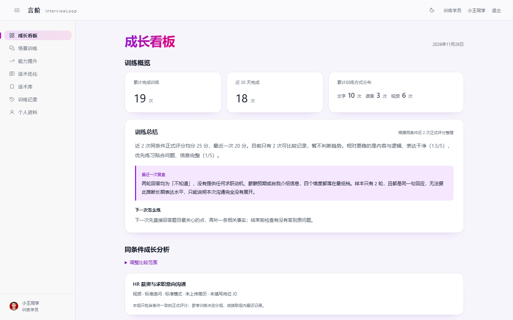

| 界面块 | 前端代码 | 接口 | 后端代码 | 表 |
|---|---|---|---|---|
| 左侧标题"面试，是练出来的。" | LoginView.vue 静态区 | — | — | — |
| 登录/注册 Tab | LoginView.vue:85 `AuthForm` | — | — | — |
| 邮箱/密码/进入训练空间 | AuthForm.vue:77 + useAuth.ts:19 | POST /auth/login | auth/router.py:58 → auth/service.py:21 | users, refresh_tokens |
| 演示账号 + "填入"按钮 | LoginView.vue（GET 演示账号） | GET /auth/demo-accounts | auth/router.py:66 | users（seed.py:487 种下） |
| 忘记密码？ | LoginView.vue:64 | POST /auth/password-reset/request | auth/router.py:132 | password_reset_tokens |

### 5.2 成长看板 `/`（DashboardView.vue:41-45）

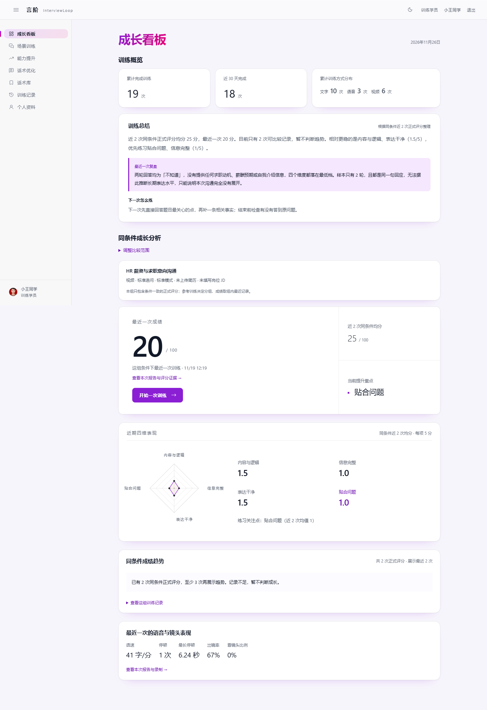

| 界面块（截图 y） | 前端代码 | 接口 | 后端代码 | 表 |
|---|---|---|---|---|
| 训练概览（y≈164） | components/dashboard/DashboardOverview.vue:8 | GET /dashboard | dashboard/router.py:15 → dashboard/service.py:33 | training_sessions, evaluations |
| 训练总结（y≈360） | components/dashboard/DashboardSummary.vue:9 | 同上（`data.summary`） | dashboard/summary.py:11 | evaluations |
| 同条件成长分析（y≈689） | components/dashboard/DashboardGrowthPanel.vue:16 | 同上 | dashboard/service.py:55 | training_sessions, scenes, resume_contexts |
| 近期四维表现 + 雷达图（y≈1269） | DashboardAbilityPanel.vue:32 + components/report/ScoreRadar.vue:6 | 同上 | dashboard/service.py:55 | evaluations |
| 同条件成绩趋势（y≈1644） | DashboardTrendPanel.vue:9 + report/ScoreTrend.vue:2 | 同上 | dashboard/service.py:55 | evaluations |
| 最近一次语音与镜头表现（y≈1855） | DashboardDeliveryPanel.vue:19 | 同上 | dashboard/service.py:55（读 delivery 字段） | training_sessions |
| 筛选/恢复自动匹配 | GrowthPanel + FiltersPanel | GET /dashboard?channel&scene_id&anchor_session_id | dashboard/router.py:15-21 | — |

### 5.3 场景训练 `/scenes`

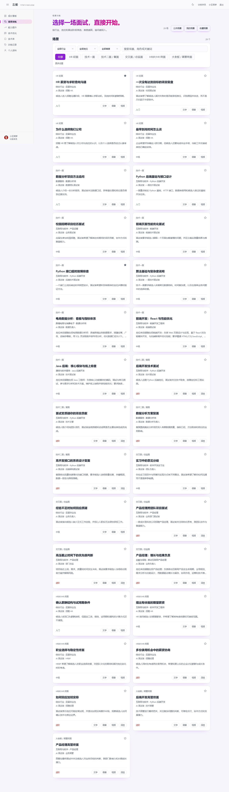

| 界面块（截图 y） | 前端代码 | 接口 | 后端代码 | 表 |
|---|---|---|---|---|
| 场景来源 Tab：公共/我的（y≈158） | ScenesView.vue:117 | GET /scenes 或 /my-scenes | scenes/router.py:17；scenes/mine_router.py:23 | scenes |
| 搜索 + 行业/岗位/难度筛选（y≈286-337） | ScenesView.vue:134-136 `SelectField` + useSceneFilters.ts:7 | 前端过滤（数据来自 GET /scenes） | scenes/service.py:55 | scenes |
| 追问强度（y≈146 起 5 档） | ScenesView.vue:146 `depth-picker` | 随建会话提交 | training/schemas.py | training_sessions.depth |
| 场景卡片（y≈500+） | components/scenes/SceneCard.vue | GET /scenes | scenes/service.py:55 | scenes, favorites |
| 收藏星标 | SceneCard @favorite → ScenesView | POST /scenes/{id}/favorite | scenes/router.py:45 → service.py:102 | favorites |
| 开始弹窗（文字/语音/视频 + 时长） | components/scenes/InterviewStartDialog.vue | POST /training-sessions（:87）或 /prepare（:99） | training/service.py:48 | training_sessions, messages |
| 我的场景面板 | components/scenes/MyScenesPanel.vue:182-199 | GET/POST/PATCH/DELETE /my-scenes | scenes/mine_router.py:23-68 → scenes/mine.py:86 | scenes（`owner_id` 非空），额度 50（mine.py:28/:92） |

### 5.4 文字对练 `/training/:id`

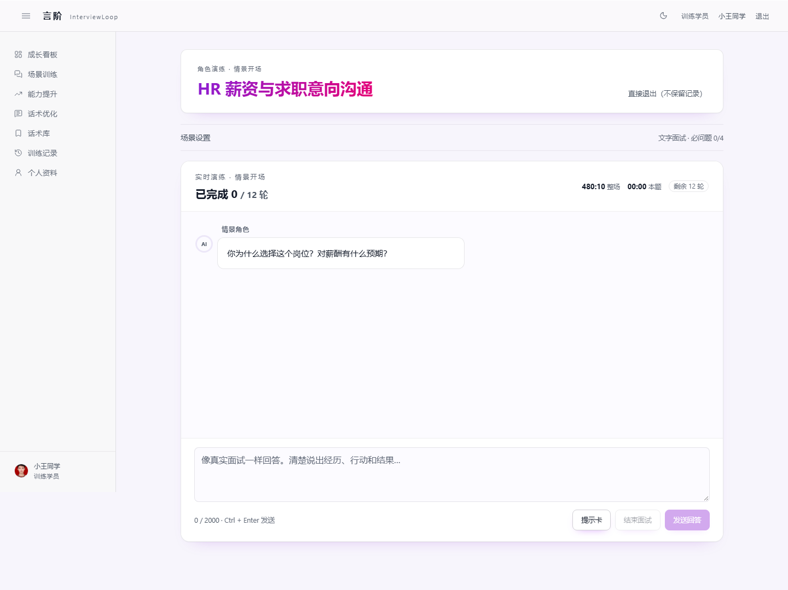

| 界面块（截图 y） | 前端代码 | 接口 | 后端代码 | 表 |
|---|---|---|---|---|
| 场景标题 + "直接退出（不保留记录）"（y≈143） | TrainingView.vue:116 + useInterviewExit.ts:7 | POST /training-sessions/{id}/discard | training/router.py:235 → training/service.py:319 | training_sessions |
| 轮次进度"已完成 0/12 轮"（y≈341） | components/training/DialoguePanel.vue:165 | — | — | — |
| 情景角色气泡（y≈430） | DialoguePanel.vue:178 | GET /training-sessions/{id} | training/router.py:223 → service.py:… | messages |
| 输入框 + Ctrl+Enter（y≈818） | DialoguePanel + VoiceComposer | POST /training-sessions/{id}/messages/complete | training/router.py:259 → training/service.py:553（流式版 :355） | messages, training_sessions |
| 提示卡（y≈932 左） | DialoguePanel → useTrainingSession | POST /training-sessions/{id}/hint | training/router.py:268 → service.py:784 | messages（读）, training_sessions |
| 结束面试（y≈932 中） | useTrainingSession.finish(:78) | POST /training-sessions/{id}/finish | training/router.py:274 → training/workflow.py:13 → service.py:339 → evaluations/service.py:42 | evaluations, evaluation_evidence, training_plans |
| 发送回答（y≈932 右） | useTrainingSession.send(:18) | 同"输入框" | 同上 | messages |
| 粘贴 JD / 删除简历 | TrainingView.vue:23 / :103 | POST, DELETE /training-sessions/{id}/jd | training/router.py:329/:338 → service.py:766 | training_sessions, resume_contexts |

### 5.5 评分报告 `/report/:id`（ReportView.vue，900 行）

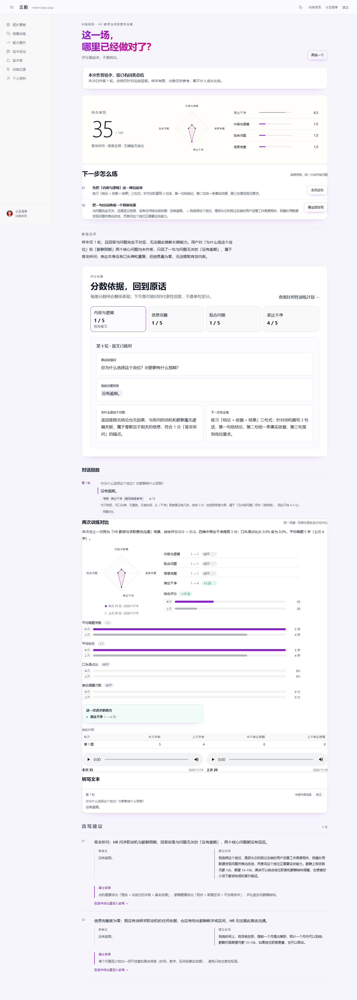

| 界面块（截图 y） | 前端代码 | 接口 | 后端代码 | 表 |
|---|---|---|---|---|
| 四维总分与结论（y≈115） | ReportView.vue 头部 + `AnimatedNumber` | GET /evaluations/{id} | evaluations/router.py:25 → evaluations/service.py:236 | evaluations |
| 评分质量提示（降级/样本不足） | components/report/EvaluationQuality.vue（ReportView.vue:331） | 同上 | evaluations/quality.py:57；evaluations/service.py:465 | evaluations.degraded |
| 下一步怎么练（y≈683） | ReportView.vue:371 | 同上（`evidence.nextAction`） | evaluations/service.py:236 | evaluation_evidence |
| 分数依据，回到原话（y≈1132） | components/report/ScoreEvidencePanel.vue:37 | 同上 | evaluations/service.py:236 → report_queries.py:23 | evaluations, evaluation_evidence |
| 迁移/能力评估 | components/report/InterviewEvidencePanel.vue:9（ReportView.vue:390） | 同上（`evaluation.assessment`） | evaluations/service.py:42 | evaluations.assessment |
| 对话回放（y≈1882，含同题对比按钮） | ReportView.vue:409 + 同题对比 | GET /training-sessions/{id}/same-question/{round} | training/router.py:415 → training/comparison.py:32 | messages, training_sessions |
| 两次训练对比（y≈2093） | components/report/TrainingComparison.vue:130（ReportView.vue:457） | GET /evaluations/{id}/comparison | evaluations/router.py:31 → comparison_view.py:47 | evaluations, training_sessions, scenes |
| 转写文本 + 修正（y≈3129） | ReportView.vue:482 + :260 | PATCH /training-sessions/{id}/transcript/{round} | training/router.py:362 → training/transcript.py:5 | messages |
| 改写建议（y≈3319） | ReportView.vue:589 | 由评分响应携带 | evaluations/service.py:42（LLM 第二遍 :152） | evaluations.evidence |
| 自评 | components/report/ReportSelfReview.vue:35（ReportView.vue:509） | PUT /training-sessions/{id}/self-review | training/router.py:344 | training_sessions |
| 重评按钮 | useTrainingReport.ts:22 | POST /evaluations/{id}?force=true | evaluations/router.py:16 | evaluations, evaluation_evidence |

### 5.6 训练记录 `/history`

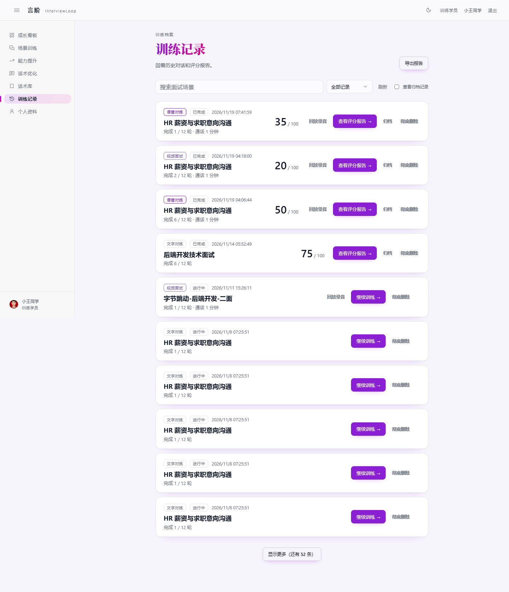

| 界面块（截图 y） | 前端代码 | 接口 | 后端代码 | 表 |
|---|---|---|---|---|
| 标题"训练记录"（y≈167） | TrainingHistoryView.vue:167 | GET /training-sessions | training/router.py:167 | training_sessions, scenes, evaluations |
| 导出报告（y≈160） | TrainingHistoryView | GET /training-sessions/export | training/router.py:179（直查三表） | 同左 |
| 搜索 + 筛选（y≈226/173） | TrainingHistoryView.vue:173 `SelectField` | GET /training-sessions?... | training/router.py:167 | — |
| 记录卡片（y≈336/709） | TrainingHistoryView.vue:191 | 同上 | training/router.py:167 | training_sessions |
| 查看评分报告（y≈197） | RouterLink → /report/:id | GET /evaluations/{id} | evaluations/router.py:25 | evaluations |
| 回放录音（y≈334） | TrainingHistoryView（recordingUrl） | GET /media/recordings/{name} | recordings/router.py:27（**无 /api/v1 前缀**） | 磁盘文件 |
| 彻底删除（y≈334） | TrainingHistoryView.vue:110 + 弹窗 DeleteTrainingDialog.vue:28 | DELETE /training-sessions/{id} | training/router.py:229 → service.py:272 | training_sessions + 级联 evidence/messages/resume |
| 归档/恢复 | TrainingHistoryView.vue:94 | POST /archive / /restore | training/router.py:310/:316 | training_sessions.archived_at |

### 5.7 能力提升（计划列表）`/plans`

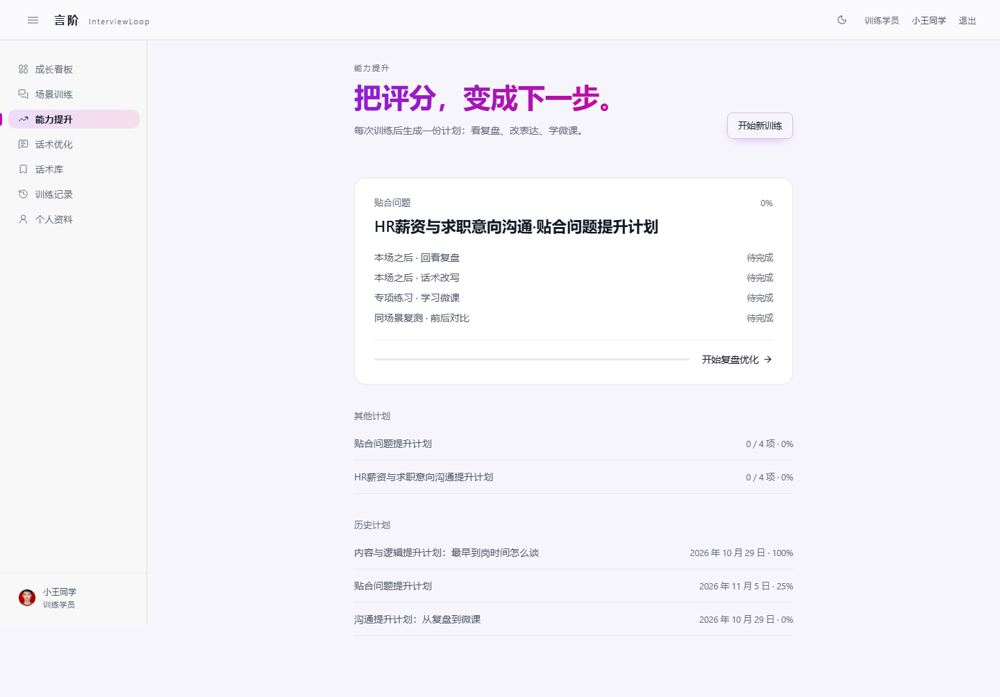

| 界面块（截图 y） | 前端代码 | 接口 | 后端代码 | 表 |
|---|---|---|---|---|
| 标题"把评分，变成下一步。"（y≈56） | TrainingPlansView.vue:56 | GET /training-plans | plans/router.py:86 → plans/service.py:63 | training_plans |
| 主计划卡（y≈310） | TrainingPlansView.vue:78 | 同上 | plans/service.py:302（视图拼装） | training_plans |
| 其他计划（y≈590）/ 历史计划（y≈747） | TrainingPlansView.vue:92 / :104 | 同上 | plans/service.py:63 | training_plans |

### 5.8 计划详情 `/plans/:id`

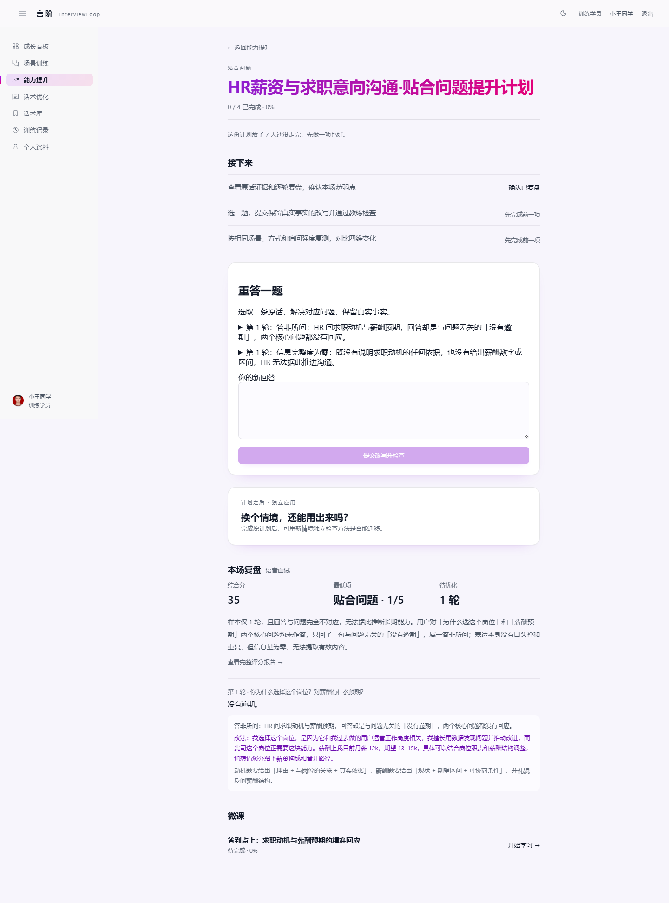

| 界面块（截图 y） | 前端代码 | 接口 | 后端代码 | 表 |
|---|---|---|---|---|
| 计划标题（y≈217） | TrainingPlanView.vue:217 | GET /training-plans/{id} | plans/router.py:92 → service.py:76 | training_plans |
| 接下来（任务卡，y≈226） | TrainingPlanView.vue:226 | POST /training-plans/{id}/tasks/{k}/complete | plans/router.py:98 → service.py:85（:279 写 course_progress） | training_plans.tasks, course_progress |
| 重答一题（y≈607） | components/training/PlanRewrite.vue:10（TrainingPlanView.vue:244） | POST 同任务完成 | plans/service.py:85 | messages, training_sessions |
| 新题迁移验证（y≈1047） | components/training/TransferAssessmentPanel.vue:24 | POST /training-plans/{id}/transfer | plans/router.py:43 → plans/transfer.py:71 | training_sessions, messages, resume_contexts |
| 本场复盘（y≈1212） | TrainingPlanView.vue:248 + PlanComparison | GET /evaluations/{id} | evaluations/router.py:25 | evaluations |
| 微课（y≈1741） | TrainingPlanView.vue:293 | POST /training-plans/{id}/lesson 与 /lesson/video | plans/router.py:51/:57 → lesson_videos.py:145 | training_plans, lesson_video_jobs |
| 视频出片进度 | `lesson/video/state` 轮询 | GET /training-plans/{id}/lesson/video/state | plans/router.py:63 → lesson_videos.py:260 | lesson_video_jobs |

### 5.9 话术优化 `/scripts` 与话术库 `/scripts/saved`

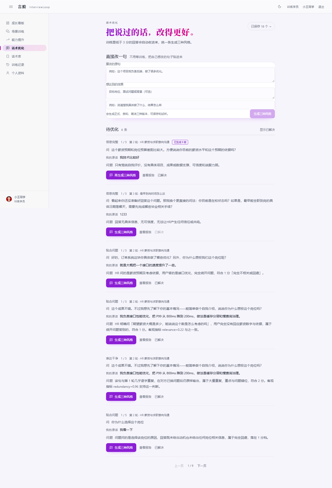
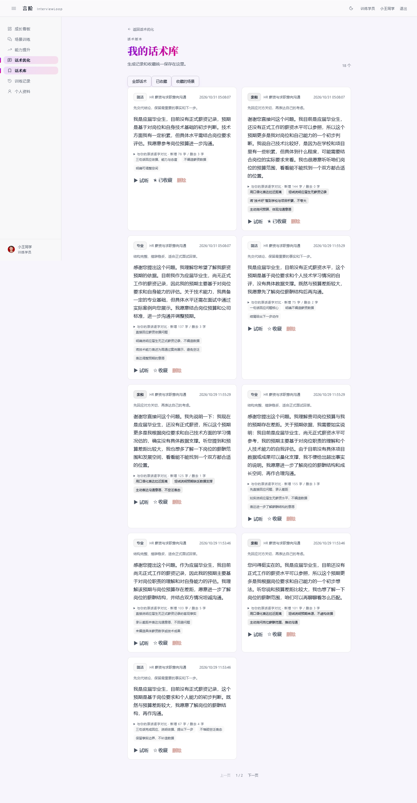

| 界面块 | 前端代码 | 接口 | 后端代码 | 表 |
|---|---|---|---|---|
| 标题"把说过的话，改得更好。"（y≈181） | ScriptStudioView.vue:181 | — | — | — |
| 直接改一句 + 面试背景 + 生成三种风格（y≈191~473） | ScriptStudioView.vue:191 | POST /scripts/generate | scripts/router.py（scripts/service.py:61 生成） | scripts |
| 三种风格卡片 / 收藏 / 试听 | ScriptVersionCard（:211/:239/:302）+ useScriptPreview.ts:31 | POST /scripts/preview；POST /scripts/{id}/favorite | scripts/router.py:74 等 | scripts, favorites |
| 待优化列表 + 分页（y≈257/1988） | ScriptStudioView.vue:257/:319 | GET /training-sessions/mistakes；PATCH /mistakes/state | training/router.py:55/:79 → evaluations/service.py:259/:435 | mistake_states, evaluations |
| 话术库列表 / 删除 | SavedScriptsView.vue:101/:66 | GET /scripts；DELETE /scripts/{id} | scripts/router.py | scripts |

### 5.10 收藏 `/favorites`

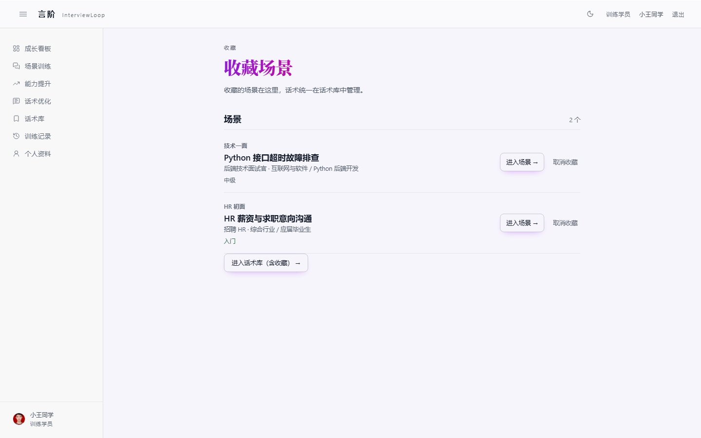

| 界面块 | 前端代码 | 接口 | 后端代码 | 表 |
|---|---|---|---|---|
| 收藏场景列表 | FavoritesView.vue | GET /scenes/favorites | scenes/router.py:33 → service.py:44 | favorites, scenes |
| 取消收藏 | FavoritesView.vue:17 | POST /scenes/{id}/favorite | scenes/router.py:45 → service.py:102 | favorites |

### 5.11 账号与偏好 `/profile`

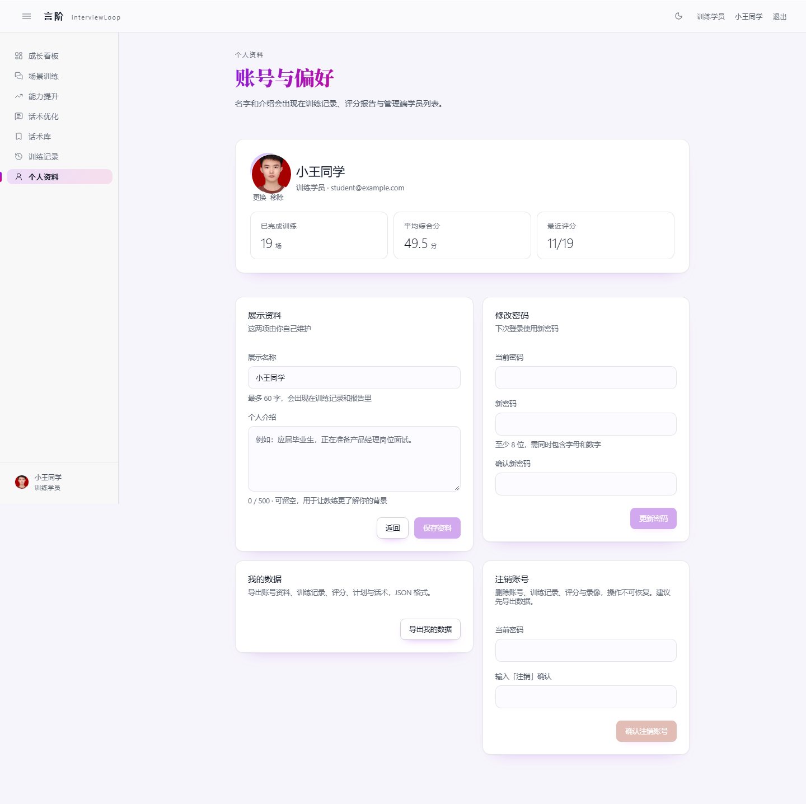

| 界面块（截图 y） | 前端代码 | 接口 | 后端代码 | 表 |
|---|---|---|---|---|
| 标题 + 统计（y≈180/212） | ProfileView.vue:180/:212 | GET /auth/me、/auth/me/stats | auth/router.py:108/:186 → auth/service.py:171 | users, training_sessions, evaluations |
| 展示资料 / 保存（y≈553/924） | ProfileView.vue:242 | PATCH /auth/me | auth/router.py:191 | users |
| 修改密码（y≈553 下） | ProfileView.vue:165 | PATCH /auth/me/password | auth/router.py:166 → auth/service.py:137 | users |
| 头像 | ProfileView.vue:104 | PUT /auth/me/avatar | auth/router.py:172 → service.py:157 | users |
| 导出我的数据（y≈1105） | ProfileView.vue:119 | GET /auth/me/export | auth/router.py:178 → account/export.py:32 | 8 表汇总导出 |
| 注销账号（y≈1024/1287） | ProfileView.vue:149 | DELETE /auth/me/delete | auth/router.py:155 → account/deletion.py:86 → purge_user_rows(:55) | 逐表删（OWNED_TABLES:39） |

### 5.12 语音面试 `/voice` / 视频面试 `/video`

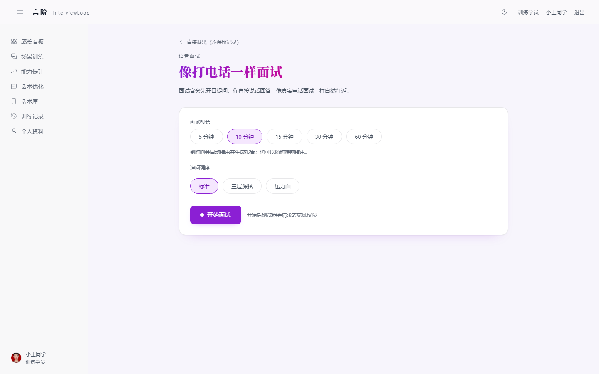
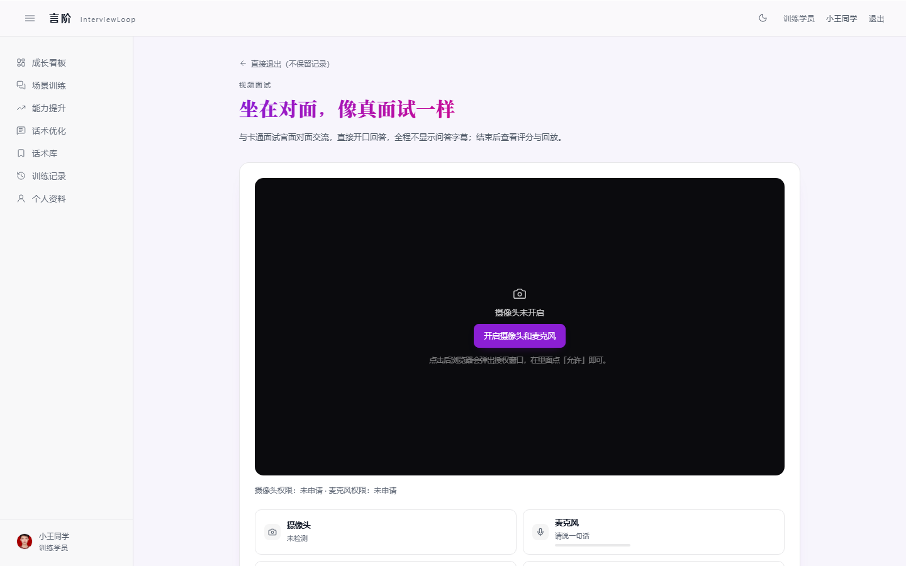

| 界面块 | 前端代码 | 接口 | 后端代码 | 表 |
|---|---|---|---|---|
| 标题"像打电话一样面试"/"坐在对面，像真面试一样"（y≈59 / :323） | VoiceCallView.vue:59 / VideoInterviewView.vue:323 | GET /voice/status | main.py:279（`/api/v1/voice/status`） | — |
| 时长 chips + 追问强度（y≈310/395~429 与 1000/1083~1117） | VoiceCallView / VideoInterviewView 内联 | — | 随会话创建提交 | training_sessions |
| 开始面试（:98 / :402） | VoiceCallView.vue:98 / VideoInterviewView.vue:402 | POST /voice/ws-ticket → WS /voice/ws | voice/router.py:119 → :126（豆包）/:301（pipecat） | — |
| 摄像头/麦克风权限引导 | VideoInterviewView.vue:409-410 `PermissionDialog` | — | — | — |
| 实时面试房间（对话 + 数字人） | components/training/LiveInterviewRoom.vue:1011 + media/AvatarPresenter.vue | 数字人令牌 GET /avatar/simli-session | avatar/router.py:12 → service.py:48 | — |
| 结束并出报告 | LiveInterviewRoom → useInterviewSubmission.ts:29/:33 | POST /voice/sessions（FormData）→ POST /training-sessions/{id}/finish | voice/router.py:209 → voice/session.py:52；video/metrics.py:122；video/segments.py:25 | training_sessions, messages, evaluations |
| 退出清理 | LiveInterviewRoom.vue:871/:888 | POST /training-sessions/{id}/discard | training/router.py:235 | training_sessions |

### 5.13 微课 `/plan-lesson`

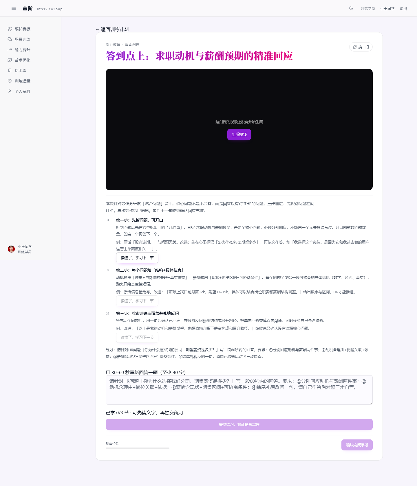

| 界面块 | 前端代码 | 接口 | 后端代码 | 表 |
|---|---|---|---|---|
| 讲稿与分步 | components/courses/PersonalizedLesson.vue（LegacyLessonView.vue:16） | GET /training-plans/{id} | plans/router.py:92 → service.py:379（LLM :164） | training_plans, scenes, evaluations |
| 完成一步 / 整课 / 练习 | useCourseLearning.ts:32/:46/:60 | POST /steps/{i}/complete、/course/complete、/practice | plans/router.py:116/:110/:124 → service.py:198/:224/:505 | training_plans.tasks, course_progress, courses |

### 5.14 管理台 `/admin` 与学员报告 `/admin/learners/:id`

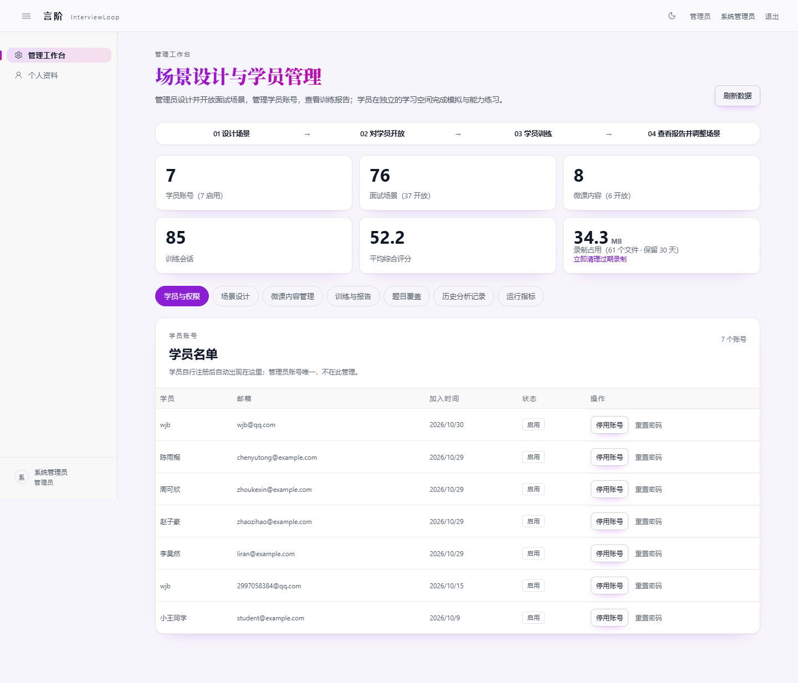
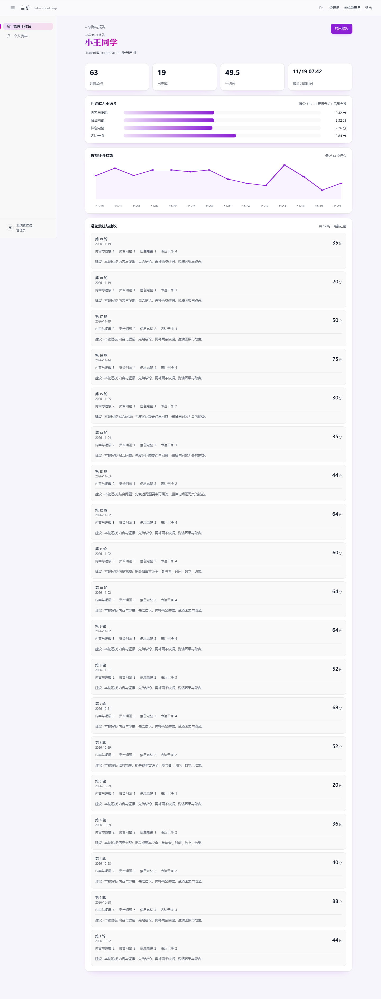

| 界面块 | 前端代码 | 接口 | 后端代码 | 表 |
|---|---|---|---|---|
| 运行指标 + 清理录制（y≈459） | AdminView.vue（默认 tab） | GET /admin/overview | admin/router.py:43 起（`require_admin` security.py:160） | audit_logs, model_usage_daily, analysis_tasks |
| 学员与权限（y≈516/623） | components/admin/AdminUsersPanel.vue:22（AdminView.vue:228） | PATCH /admin/users/{id}（AdminView.vue:106） | admin/router.py | users, audit_logs |
| 场景设计 | AdminScenesPanel（AdminView.vue:229） | POST/PATCH/DELETE /admin/scenes | admin/router.py | scenes, audit_logs |
| 微课内容管理 | AdminCoursesPanel（:230） | POST/PATCH /admin/courses | admin/router.py | courses |
| 运行指标图表（y≈241~251） | AdminMetricsPanel + MiniBarChart/MiniDonut | GET /admin/overview | admin/router.py | model_usage_daily |
| 题目覆盖 | QuestionRubricEditor 等 | /admin/* | admin/router.py | scenes.question_bank |
| 历史分析记录 | AdminTasksPanel（:232） | GET /tasks/{id} | tasks/router.py:15 | analysis_tasks |
| 训练与报告（y≈516） | AdminSessionsPanel.vue:101（:233） | GET /admin/reports/export（AdminView.vue:233） | admin/router.py | training_sessions, evaluations |
| 学员能力报告（y≈278） | LearnerReportPanel + MiniBarChart/MiniLineChart（LearnerReportView.vue:176/:185） | GET /admin/learners/{id}/report/export | admin/router.py | evaluations, training_sessions |

### 5.15 其余三个说明页

| 页面 | 代码 | 说明 |
|---|---|---|
| `/privacy` | PrivacyView.vue（全静态，无接口） | 数据留存口径说明 |
| `/reset-password` | ResetPasswordView.vue:29 | POST /auth/password-reset/confirm（auth/router.py:141） |
| `/verify-email` | VerifyEmailView.vue:20 | POST /auth/verify-email/confirm（auth/router.py:124） |

---

## 6. 五条端到端链路（照着读一遍就通）

**① 文字对练一轮问答**
`DialoguePanel` 提交 → `useTrainingSession.send()`（composables/useTrainingSession.ts:18，先本地插占位消息 :43）→ `POST /training-sessions/{id}/messages/complete`（:45，75s 超时）→ `training/router.py:259` → `training/service.py:553`（流式版 `stream_reply` :355 → LLM `stream_text` :500）→ 写 **messages**（:449 用户 / :525 助手）。

**② 结束对练 → 评分 → 勾掉计划任务**
`useTrainingSession.finish()`（useTrainingSession.ts:78）→ `POST /training-sessions/{id}/finish`（training/router.py:274）→ `training/workflow.py:13` → `training/service.py:339` → `evaluations/service.py:42`（两遍 LLM :117/:152）→ 先删旧证据(:198)再写 **evaluations / evaluation_evidence**（:201/:206）→ `plans/service.py:85` 写 **training_plans / course_progress**（:283）。

**③ 语音/视频面试 → 上传 → 报告**
`LiveInterviewRoom` → `useInterviewRecording.recordingBlob()` → `useInterviewSubmission.submitReport()`（:19）→ `POST /voice/sessions`（:29，FormData 含 sceneId/turns/engine/audio|video，180s）→ `voice/router.py:209` → `voice/session.py:52` 写 **training_sessions**（voice/session.py:52）+ messages（视频另过 `video/metrics.py:122`、`video/segments.py:25`）→ 再 `POST /training-sessions/{id}/finish`（:33）→ **evaluations**。上传成功即记 `submissionStage='uploaded'`（:31），重试不重传。

**④ 计划 → 微课 → 视频出片**
`TrainingPlanView` 任务卡 → `POST /training-plans/{id}/tasks/{k}/complete`（plans/router.py:98）→ `plans/service.py:85` → `POST /training-plans/{id}/lesson`（router.py:51）→ `service.py:379` 生成讲稿（LLM :164）→ `POST /{id}/lesson/video`（router.py:57）→ `lesson_videos.py:145` → `enqueue_lesson_video_job`(:122) 写 **lesson_video_jobs**（:131）→ 后台 `process_next_job`(:260) 调 `lessons/remotion_render.py:115`（remotion_render.py:115-123 `npx remotion render src/index.tsx LessonVideo` 跑 `video/`）→ 前端轮询 `lesson/video/state`（router.py:63）。

**⑤ 鉴权与 401 自愈**
`useAuth.login()`（useAuth.ts:19）→ `POST /auth/login` → `setAccessToken`（api.ts:12）。任意请求 401 → 拦截器（api.ts:34-54）→ 单飞 `refreshToken()`（api.ts:56）→ `POST /auth/refresh`（auth/router.py:77 → service.py:104 轮换，单用户最多 5 条 token :65）；刷新失败清 token 并派发 `auth:expired`（api.ts:49）→ main.ts:20 回登录。登出前 `activeTrainingAttempt.ts:18` 会先 `POST /training-sessions/{id}/discard`。

---

## 7. 改功能速查

| 我要... | 动的文件（按顺序） |
|---|---|
| 改页面文案/布局 | 对应 `views/*.vue` 或 `components/**`；文案若在后端总结里（如"下一步先…"）则改 `dashboard/summary.py:11` 或 `evaluations/service.py` |
| 加一个接口 | `features/<包>/router.py` 加路由 → `service.py` 写逻辑 → `schemas.py` 出入参 → 前端 `composables/use*.ts` 加调用 → 视图接数据 |
| 加一张表 | `db/models.py` 加模型 → `backend/migrations/versions/` 新建迁移（head 现为 `20261124_0052`）→ `alembic upgrade head` |
| 改评分规则 | `evaluations/scoring.py:161`（规则子指标）与 `evaluations/service.py:42`（两遍 LLM 与权重）→ 证据口径 `evaluations/quality.py:57` |
| 改追问策略 | `training/evidence.py:43`（证据驱动追问）、`training/policy.py`（重复/回避判定）、`training/rubrics.py:38` |
| 改看板统计口径 | `dashboard/service.py:55` + `dashboard/summary.py:11`，口径文档 `docs/成长看板统计口径.md` |
| 改计划任务契约 | `plans/service.py:85` 与 `plans/generation.py:70`；契约已冻结在迁移 `plan_tasks_v2.py:8`/`20261117_0048`，改动要走新迁移 |
| 加场景/题库 | `content/question-banks.json` → `db/seed.py:520` 灌入 `scenes.question_bank`；自建场景走 `scenes/mine.py:86` |
| 改实时语音 | `voice/router.py`（`/voice/ws` :126 豆包 / `/voice/ws/pipeline` :301）+ `voice/pipeline.py:115` |
| 改数字人 | `avatar/service.py:48`（Simli 令牌）+ 前端 `lib/avatarConfig.ts:3` 降级顺序 |
| 改微课视频 | `lessons/`（Python 引擎 video.py:176 / Remotion remotion_render.py:60）+ 渲染工程 `video/` |

---

## 8. 陷阱与已知未解疑点

**会误导人的地方**

1. `content/scene-bank.yaml` 名字像源数据，运行时零引用——题库真身是 `content/question-banks.json`。
2. `tools/remotion` 是另一套 Remotion 副本，代码里无人调用，且被 `.gitignore` 忽略；真实渲染工程在 `video/`。
3. `frontend/src/lib/api.ts` **没有集中端点表**，只有 5 个导出；URL 散在 composables 里（见 4.5）。
4. `GET /media/recordings/{name}` 与 `/media/lessons`、`/media/tts` 是裸挂载静态目录（main.py:286-297），不带 `/api/v1`。
5. `/api/v1/video-interviews` 是恒返回 410 的墓碑（video/router.py:8），视频面试实际复用 `/api/v1/voice/ws` 与 `/voice/sessions`。
6. 管理员账号只能进 `/admin`、`/profile`、`/admin/learners/:id`（router.ts:44），访问其他页面会被重定向。
7. `docs/evidence/` 的 21 张验收截图被 `.gitignore:51` 忽略，clone 后看不到。
8. `components/ability/` 与 `components/plans/` 是空目录，别去里面找代码（能力练习 UI 在 dashboard/report 目录下）。

**本次核查尚未逐行证实的点（改动前先自己确认）**

1. `.env` 里 `MYSQL_*`/`VOLC_*` 因 `extra="ignore"`（core/config.py:13）不进 Settings，消费方在 compose 与离线脚本，未逐个核对。
2. 迁移链 52 个版本中，后 40 个版本对列的增删只做了 `create_table` 级 grep，未逐列核对；真实库表以 `models.py` + `alembic upgrade head` 为准。
3. `voice/router.py:134/:318` 直接读 `asyncio.Semaphore._value` 做并发闸门，未运行验证。
4. `lib/contracts/trainingMetadata.ts` 的字段最终落在 `training_sessions.delivery` 还是 `messages`，未逐字段比对。
5. `admin/overview` 的精确聚合来源（`audit_logs`/`model_usage_daily` 只在 models.py 出现），未在 admin 服务里逐个确认 SQL。

---

## 9. 自己复核的两条命令

```bash
# 后端接口全景（105 个路径，按前缀分组）
curl -s http://127.0.0.1:8081/openapi.json | node -e "let s='';process.stdin.on('data',d=>s+=d).on('end',()=>{const j=JSON.parse(s);Object.keys(j.paths).forEach(k=>console.log(k))})"

# 前端所有端点调用点（前后端映射的唯一可靠来源）
grep -rn "api\.\(get\|post\|patch\|put\|delete\)(" frontend/src/composables frontend/src/views frontend/src/components
```

界面截图可重跑：`cd frontend && node scripts/capture-guide.mjs`（会以 demo 学员/管理员登录，逐页整页截图到 `docs/screenshots/guide/`）。


